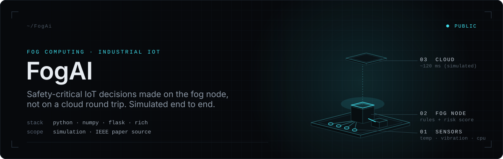
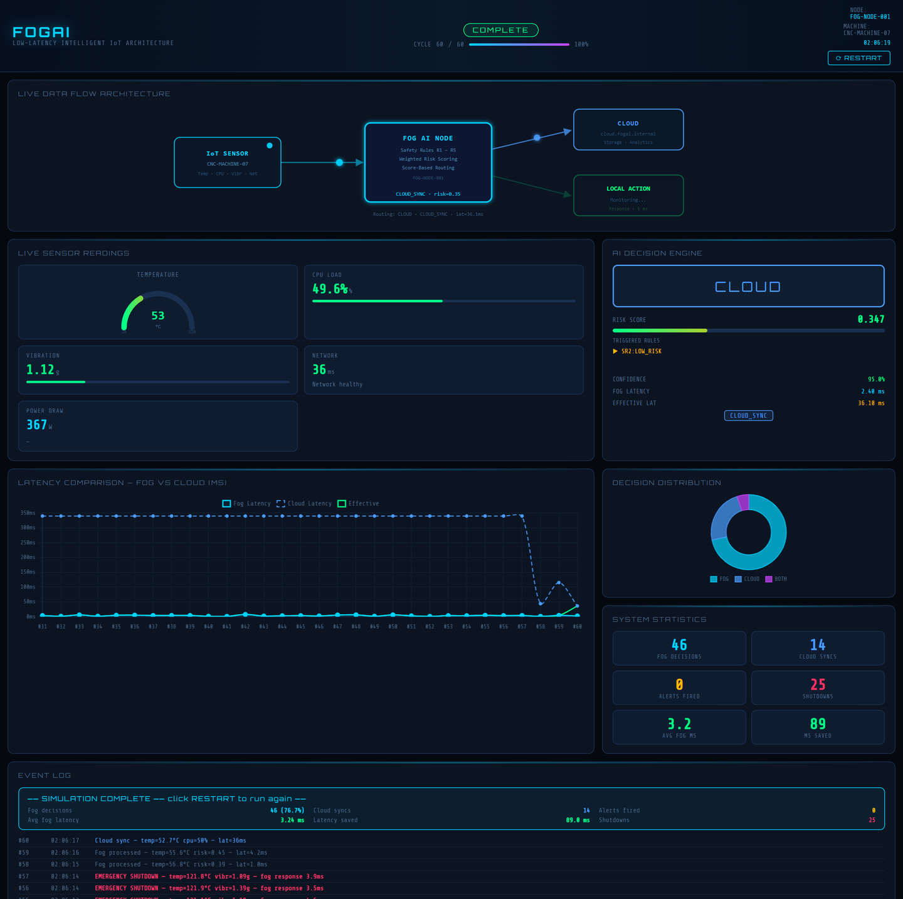
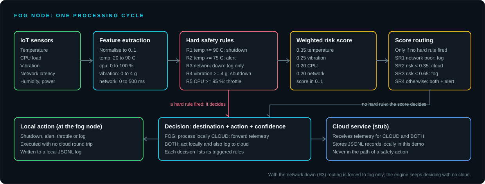

<div align="center">



<br />

**Intelligent fog computing for real-time IoT.**
A low-latency, AI-driven fog architecture for real-time decision-making in smart manufacturing, with a working simulation and live dashboard.

<br />


[Overview](#overview) · [Dashboard](#live-dashboard) · [Architecture](#architecture) · [Decision engine](#decision-engine) · [Simulation](#simulation) · [Results](#results) · [Run it](#running-it) · [Paper](#paper)

</div>

<br />

## Overview

FogAI shows how safety-critical decisions can move next to the machine instead of waiting on a cloud round trip. A **fog node** reads each sensor sample, scores the risk, applies hard safety rules, and decides locally whether to act, alert, throttle, or shut down. Routine telemetry goes on to the cloud for storage; if the network degrades or drops, the node keeps working on its own.

- **Simulation, not hardware.** The sensors, the cloud and all latencies are simulated. The repository contains no deployment to physical devices.
- **Interpretable, not a trained model.** The decision engine combines five hard safety rules with a weighted risk score and four routing rules. There is no learned model in this repository, which keeps every decision explainable: each one lists the rules that triggered it.
- **Final year project.** Domain: AI, IoT, fog computing, smart manufacturing (Industry 5.0).

## Live dashboard

`web_app.py` serves a live dashboard that streams the running simulation to the browser: the data-flow diagram, sensor gauges, the decision and risk score for each cycle, a fog-versus-cloud latency chart, decision distribution, and an event log.

<p align="center">
  
  <br />
  <sub>Captured from <code>web_app.py</code> at the end of a 60-cycle run.</sub>
</p>

## Architecture

<p align="center">
  
</p>

[`fog_node.py`](fog_node.py) runs each cycle:

1. The [decision engine](ai_engine.py) decides (see below).
2. The action runs immediately at the fog node, with no cloud round trip.
3. If the destination is `CLOUD` or `BOTH`, telemetry is sent to the [cloud service stub](cloud_stub.py), which stores it as JSONL on disk.
4. The reading and decision are appended to a local JSONL log.

## Decision engine

[`ai_engine.py`](ai_engine.py) works in four steps: extract features, apply hard rules, compute the risk score, and route by score only when no hard rule fired. Thresholds and weights live in [`config.py`](config.py).

**Hard safety rules** (highest priority):

| Rule | Condition | Action | Destination |
| --- | --- | --- | --- |
| R1 | Temperature ≥ 90 °C | Emergency shutdown | Both |
| R2 | Temperature ≥ 75 °C | Alert | Both |
| R3 | Network offline | Fog-only operation (log) | Fog |
| R4 | Vibration ≥ 4.0 g | Emergency shutdown | Both |
| R5 | CPU load ≥ 95 % | Throttle machine | Both |

When several rules fire, shutdown takes precedence, and R3 forces the destination to fog.

**Weighted risk score** from normalised features: temperature 0.35, vibration 0.25, CPU 0.20, network 0.20, giving a score between 0 and 1.

**Score routing** (only when no hard rule fired):

| Rule | Condition | Routing |
| --- | --- | --- |
| SR1 | Cloud latency ≥ 150 ms | Fog, log only |
| SR2 | Risk < 0.35 | Cloud sync |
| SR3 | Risk < 0.65 | Fog, log only |
| SR4 | Otherwise | Both, with an alert |

Each decision also carries a confidence value, the triggered rules, a severity, and a plain-text reason.

## Simulation

[`sensor.py`](sensor.py) generates temperature, humidity, CPU load, vibration, network latency and power draw with Gaussian noise, and injects a fixed schedule of events across 60 cycles:

| Cycle | Event |
| --- | --- |
| 12 | Temperature spike |
| 22 | Network degradation (the link goes fully offline a few cycles later) |
| 33 | Overheating begins |
| 38 | Vibration shock |
| 45 | Overheating peak |
| 52 | Network down |
| 58 | System recovery |

Noise is random, so numbers differ from run to run; the event schedule does not.

## Results

The fog and cloud latencies are drawn from the simulation model in `config.py` (fog about 3 ms, cloud about 120 ms with jitter), so these are simulation outputs rather than hardware measurements.

Statistics from 300 full 60-cycle runs of the engine:

| Metric | Mean | Range across runs |
| --- | ---: | ---: |
| Decisions handled at the fog (`FOG` or `BOTH`) | 80 % | 72 % to 90 % |
| Average fog decision latency | 3.1 ms | 2.6 to 3.9 ms |
| Latency saved per cloud-routed reading | 82 ms | 50 to 107 ms |
| Readings routed to cloud only | 12 | 6 to 17 |
| Emergency shutdowns | 25 | 25 (every run) |

"Latency saved" is the mean cloud round trip of cloud-routed readings minus the mean fog latency. Shutdowns are identical in every run because the fault schedule is fixed.

> [!NOTE]
> In the default scenario, temperature jumps from the normal range straight past 90 °C, so rule R2 (alert) and score rule SR4 are implemented but never fire, and no alerts are raised. R3, R4 and R5 do fire.

## Running it

**Requirements:** Python 3.8 or later (verified here on 3.14). Dependencies are in [`requirements.txt`](requirements.txt): `rich`, `numpy`, `colorama` and `flask`.

```bash
pip install -r requirements.txt
```

**Terminal simulation**

```bash
python main.py                 # 60 cycles with the live terminal dashboard
python main.py --cycles 80 --fast
python main.py --no-dash       # plain log output
```

| Option | Description |
| --- | --- |
| `--cycles N` | Number of sensor cycles (default 60) |
| `--fast` | Run without the pacing delay |
| `--no-dash` | Disable the terminal dashboard |

On Windows, `run.bat` installs the three core packages and runs 60 cycles.

**Web dashboard**

```bash
python web_app.py              # opens http://localhost:5000
```

`run_web.bat` does the same on Windows. The page loads Chart.js and two Google Fonts from CDNs, so it needs an internet connection.

**Output.** Each run writes a decision log under `logs/`, simulated cloud telemetry under `data/`, and a text report under `reports/` (for terminal runs). These folders are git-ignored.

## Project structure

```text
FogAi/
├── ai_engine.py          decision engine: features, safety rules, risk score, routing
├── fog_node.py           per-cycle processing: decide, act, forward, log
├── sensor.py             sensor simulator with a scheduled fault scenario
├── cloud_stub.py         simulated cloud endpoint (JSONL storage)
├── config.py             thresholds, weights, latency model, simulation settings
├── main.py               terminal simulation runner
├── dashboard.py          Rich terminal dashboard
├── report_generator.py   text report for each run
├── web_app.py            Flask server streaming the simulation over SSE
├── templates/index.html  live web dashboard
├── paper/                IEEE conference paper source
├── assets/readme/        README banner and diagram
└── docs/screenshots/     dashboard screenshot
```

## Paper

[`paper/`](paper) holds the LaTeX source of the conference paper *FogAI: A Lightweight Hybrid Decision Engine for Low-Latency Safety-Critical Processing in Industrial IoT Fog Nodes* by Adwaith Sajikumar and Dr. G Naveen Sundhar, written for ICNCCom 2026 in IEEE conference format. The conference paper was accepted and presented; proceedings are pending. A journal extension of this work is a separate, private research archive.

To build it, install a TeX distribution with the `IEEEtran` class, then from `paper/` run `compile.bat` (or `pdflatex`, `bibtex`, `pdflatex`, `pdflatex` on `fogai_icnccom2026`).

## Scope and limitations

- Everything runs in simulation: sensors, cloud endpoint and latencies are modelled, and no physical or networked deployment is included.
- The decision engine is rule-based with a weighted score; there is no trained model.
- There is no automated test suite.
- Figures from the paper's own analysis (for example hardware footprint) are not reproduced by code in this repository.

---

<div align="center">
<sub>FogAI · Final Year Project · AI / IoT / Fog Computing / Smart Manufacturing</sub>
</div>
